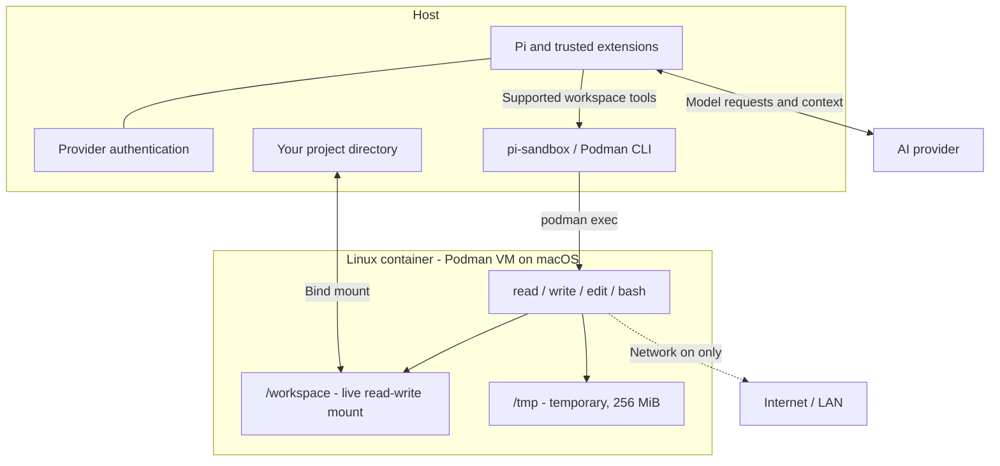

# Pi Sandbox

Run Pi's workspace tools in a lightweight **Podman container**, while **Pi, provider authentication, and model requests stay on your host**. Your project is mounted live: edits appear immediately on both sides, with no copying or synchronization step.

> **Early testing release.** This isolates supported tool execution, not the Pi process itself. The mounted project remains writable, and trusted extensions still run on the host. Read the [security boundary](#security-boundary) before using it with sensitive files.

## How it works



Stopping the container blocks tools; it never switches them back to the host. Turning off container networking does **not** stop Pi's host-side model requests.

## Contents

- [Requirements](#requirements)
- [Quick start](#quick-start)
- [Commands](#commands)
- [Workspace indicator](#workspace-indicator)
- [Startup flags](#startup-flags)
- [Toolbox and limits](#lightweight-toolbox-not-a-full-dev-environment)
- [Security boundary](#security-boundary)
- [Efficiency and storage](#efficiency-and-storage)
- [Troubleshooting](#troubleshooting)
- [Development and testing](#development-and-testing)

## Requirements

- [Pi](https://www.npmjs.com/package/@earendil-works/pi-coding-agent) with extension APIs compatible with **1.5.0** (the development/test baseline).
- [Podman](https://podman.io/docs/installation) installed and available on your host `PATH`.
- **macOS:** a running Podman machine. **Linux:** local rootless Podman is recommended. macOS has been integration-tested; Linux-specific mount permissions may need setup (see [storage notes](#efficiency-and-storage)). Windows is not currently documented or tested.
- A local project directory to mount. Arbitrary remote Podman servers are not supported: mount sources must refer to your local project.
- For a source checkout: Node.js/npm compatible with your Pi installation.

This package does **not** initialize/start your Podman VM, install itself globally, or alter Podman settings.

## Quick start

### 1. Prepare Podman

Check that Podman is reachable:

```sh
podman info
```

On macOS, if you have not created a Podman machine yet, run `podman machine init` once, then `podman machine start`. For an existing machine, use `podman machine list` to check its state.

### 2. Load the extension

Download or clone this package, then install its dependencies from the checkout directory:

```sh
cd /path/to/pi-sandbox
npm install
```

`/path/to/...` paths in this guide are placeholders; replace them with your own paths. Start Pi **from the project you want to edit**, not from the extension's checkout:

```sh
cd /path/to/your-project
pi -e /path/to/pi-sandbox/src/index.ts
```

Loading this package immediately replaces supported tools and blocks others. Until the sandbox is started, agent tools are blocked. Use a separate Pi invocation without this package if you want ordinary host execution.

### 3. Build and start

In Pi:

```text
/sandbox build
/sandbox start
/sandbox status
```

`build` creates the shared `localhost/pi-sandbox:0.1` toolbox image. **Build once per Podman image store, not once per project.** In subsequent project directories, just use `/sandbox start`. It downloads a Debian base and packages, so the build needs network access independently of the sandbox network setting. `start` only uses a locally available image (`--pull=never`); it does not silently download one.

### 4. Optional: install for future sessions

```sh
pi install /path/to/pi-sandbox
```

Start a new Pi session, or run `/reload` in an existing one. You still need `/sandbox start` each session unless you enable [auto-start](#startup-flags). Keep the local checkout available when installing from a path.

## Commands

| Command | Behavior |
| --- | --- |
| `/sandbox start` | Start one reusable container for this session |
| `/sandbox stop` | Remove it; tools stay blocked, never fall back to the host |
| `/sandbox status` | Check current container, project, image, and network |
| `/sandbox build` | Build the shipped toolbox into the configured image tag |
| `/sandbox network off` | Disable container networking; recreate a running sandbox |
| `/sandbox network on` | Enable standard bridge networking; recreate a running sandbox |
| `/sandbox cleanup` | Confirm removal of exited containers labeled as managed by this package |

Normal exit, reload, and session replacement remove the current container. Live project changes survive. Temporary files, installed temporary tools, and background processes do not. A crash or killed host process may leave a **running** container: inspect it with `podman ps --filter label=io.pi-sandbox.managed=1` and explicitly remove the chosen container with `podman rm -f <name>`. Cleanup deliberately does not kill running containers, including those belonging to other Pi sessions.

No global prune, image deletion, volume deletion, or automatic disk-image shrinking is performed.

## Workspace indicator

An above-editor panel makes the execution boundary visible:

```text
SANDBOX ACTIVE · workspace tools execute in Podman
Project: /your/project → /workspace · LIVE read-write
Network: ON — internet / LAN access allowed · Image: localhost/pi-sandbox:0.1
Container: pi-sandbox-… · Pi + provider authentication stay on host
```

A compact sandbox footer entry is present **only while active**. Stopping removes that entry and replaces the panel with:

```text
SANDBOX OFF · agent tools blocked — no host fallback
Pi is on the host · /sandbox start to enable sandbox tools
```

The panel also shows progress while starting, stopping, building, or changing network mode. Cancellation/failure updates the indicator after the tool completes. `/sandbox status` queries Podman for an explicit container health check; the panel reflects session-managed state, not a background health poll. Shutdown clears both the panel and this extension's footer entry without replacing Pi's normal footer.

## Startup flags

```sh
pi -e /path/to/pi-sandbox/src/index.ts \
  --sandbox-auto-start \
  --sandbox-network off \
  --sandbox-image localhost/pi-sandbox:0.1
```

- `--sandbox-auto-start`: opt-in; default is stopped.
- `--sandbox-network on|off`: default **on**.
- `--sandbox-image <tag>`: default `localhost/pi-sandbox:0.1`.

Changes made with `/sandbox network` are session-local. After reload/restart, the startup flag/default applies again. There is no project-controlled configuration or automatic devcontainer execution.

## Lightweight toolbox, not a full dev environment

The shared image includes Bash, Git, ripgrep, file detection, standard filesystem tools, and certificates. It does not contain Pi, Node, Python, compilers, language servers, or package caches.

File tools reuse Pi's formatting, image handling, truncation, and exact-edit behavior, with filesystem operations delegated into the container. File content is passed through stdin rather than interpolated into shell commands. Absolute project paths are translated to `/workspace`; other absolute paths refer to the **container** filesystem.

If a task needs language tooling, build/select a trusted image containing it. Custom images need `/bin/sh`, Bash, `cat`, `mkdir`, `test`, `file`, and `sleep`; they must tolerate a read-only root filesystem, an unprivileged keep-id user, and writable `/tmp`. Image entrypoints are overridden. `/sandbox build` tags its output with the currently selected image, so don't use it to overwrite a custom tag unintentionally.

Default limits: 1 GiB memory, 2 CPUs, 256 processes, and 256 MiB temporary storage. Shell calls default to a 120-second deadline and can request a different timeout. File/management calls have a 60-second default deadline. Transport output is capped at 32 MiB; normal model-facing output uses Pi's 50 KiB / 2,000-line truncation.

**Cancellation, timeout, or transport failure removes the whole container.** This is deliberate: killing `podman exec` alone does not reliably kill its container-side descendants. Concurrent tool calls are affected too. Run `/sandbox start` to continue. File reads also have the 32 MiB transport cap.

Pi may spool large shell output into host session temp files. Those are not accessible as sandbox paths. For large logs, redirect into `/workspace/task.log` and read in chunks instead. Live project logs are your responsibility to remove.

## Security boundary

### What this package enforces

- `read`, `write`, `edit`, and `bash` use container operations; none fall back to host execution.
- Other tools are removed from the active loadout and blocked by a `tool_call` allowlist, including unsupported MCP/codemode tools.
- User `!` and `!!` commands also execute in the sandbox, not on the host.
- Only the selected project is intentionally bind-mounted. Home/root mounts are refused; paths containing comma, colon, or newline are currently unsupported.
- No provider credentials, host environment variables, SSH agent, or Podman/Docker control socket are forwarded.
- Read-only container root, dropped capabilities, no-new-privileges, keep-id user namespace, and resource limits.

### What it does NOT protect

- **Your mounted project:** the agent can read, overwrite, or delete everything writable there, including `.env`, `.git`, and project-local Pi configuration. Use Git, backups, and diff review.
- **Provider privacy:** Pi still sends prompts, selected project context, and tool output to the AI provider from the host. `network off` does not stop this.
- **Host-side Pi resources:** Pi still loads session history, skills, prompts, and trusted extensions on the host. A host skill file is not automatically mounted into the container. Project trust still matters.
- **Arbitrary trusted extensions:** extensions run with host privileges. An extension can spawn host processes directly, bypass tool dispatch, or override these same tools. Do not combine this package with untrusted extensions; it is not an OS sandbox for Pi itself.
- **Container escapes/runtime vulnerabilities:** use a current runtime and trusted images. On Linux, rootless Podman is recommended; this package does not configure your runtime for you.
- **Network-on egress:** standard bridge networking may reach internet, host services, and LAN services. No domain allowlist or egress proxy is provided.

### Network off

`--network=none` disables ordinary external networking from container processes. Pi's host-side model API requests continue. Changing network mode recreates the container and discards `/tmp`, but preserves live project edits. Image builds and Podman management run outside this network boundary.

## Efficiency and storage

One container is kept for the session; each tool operation uses `podman exec`. There is no project copy or synchronization loop. Typical code edits and targeted searches should work well, but each operation has CLI overhead. Bulk small-file operations, dependency installs, and watchers can be slower across macOS's VM file-sharing boundary. Performance has not yet been benchmarked.

All sessions reuse image layers. Container writable roots are read-only; temporary data is bounded by tmpfs. **The project mount has no disk quota:** generated artifacts can still fill your host disk. Image build caches, Podman logs, and the VM disk are also outside the tmpfs limit. On macOS, deleting container data does not necessarily shrink the VM disk image immediately.

No automatic SELinux relabeling is performed. On enforcing Linux systems a bind mount may need an administrator-approved label/setup; mount access failures remain failures rather than relaxing security automatically. Git worktrees whose `.git` points outside the mounted project also need special consideration and are not automatically granted extra mounts.

## Troubleshooting

| Symptom | What to check |
| --- | --- |
| Podman cannot connect | Run `podman info`. On macOS, check `podman machine list` and start your machine with `podman machine start`. |
| Image not found on start | Run `/sandbox build` once in the current Podman image store. Starting never pulls an image automatically. |
| Tools blocked after a timeout or cancellation | The container was removed to stop all child processes. Run `/sandbox start`; live project edits are preserved. |
| A command such as `node` or `python` is missing | The default toolbox is minimal. Select a trusted custom image with the required tools using `--sandbox-image`. |
| Bind mount denied | Check local project permissions and, on Linux, SELinux labeling. Home/root mounts and paths containing commas, colons, or newlines are refused. |
| A host file or skill cannot be read | Only the project is mounted. Host paths outside it are intentionally unavailable to container tools. |

## Development and testing

```sh
cd pi-sandbox
npm install
npm test
npm run typecheck
```

Opt-in real-container smoke test (build first, running Podman required):

```sh
podman build -t localhost/pi-sandbox:0.1 -f container/Containerfile container
PI_SANDBOX_INTEGRATION=1 npm test
```

The integration test mounts only a new temporary directory, verifies live writes, networking configuration, read-only root, timeout cleanup, and persistence of project changes. Set `PI_SANDBOX_TEST_IMAGE` to use another already-built toolbox image. It never starts the VM or prunes resources.

### Source layout

- `src/index.ts`: Pi tools, commands, lifecycle hooks, and tool allowlist
- `src/runtime.ts`: Podman process management, container configuration, and path translation
- `src/ui.ts`: sandbox status panel and footer
- `container/Containerfile`: shared minimal toolbox image
- `test/`: unit tests and opt-in Podman integration test

## License

[MIT](LICENSE).
