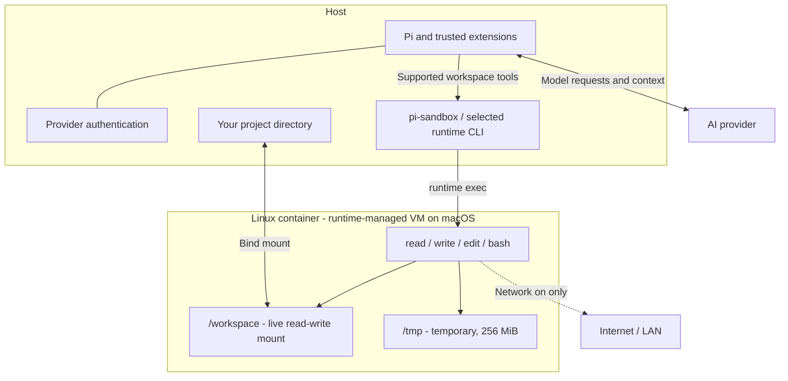

# Pi Sandbox

Run Pi's workspace tools using **Podman** (default) or **[Apple Container](https://github.com/apple/container)** (experimental), while **Pi, provider authentication, and model requests stay on your host**. Your project is mounted live: edits appear immediately on both sides, with no copying or synchronization step.

> **Early testing release.** This isolates supported tool execution, not the Pi process itself. The mounted project remains writable, and trusted extensions still run on the host. Read the [security boundary](#security-boundary) before using it with sensitive files.

## How it works



Stopping the container blocks tools; it never switches them back to the host. Turning off container networking does **not** stop Pi's host-side model requests.

## Contents

- [Requirements](#requirements)
- [Quick start](#quick-start)
- [Commands](#commands)
- [Workspace indicator](#workspace-indicator)
- [Startup flags](#startup-flags)
- [Toolbox and limits](#lightweight-toolbox-not-a-full-dev-environment)
- [Security boundary](#security-boundary)
- [Efficiency and storage](#efficiency-and-storage)
- [Troubleshooting](#troubleshooting)
- [Development and testing](#development-and-testing)

## Requirements

- [Pi](https://www.npmjs.com/package/@earendil-works/pi-coding-agent) with extension APIs compatible with **1.5.0** (the development/test baseline).
- **Podman backend:** [Podman](https://podman.io/docs/installation) on your host `PATH`. On macOS, start a Podman machine; on Linux, local rootless Podman is recommended. macOS Podman has been integration-tested; Linux mount permissions may need setup (see [storage notes](#efficiency-and-storage)).
- **Apple backend:** Apple Silicon Mac, macOS 26+, and Apple's `container` CLI on your host `PATH`, with `container system start` already run. The experimental adapter targets **container 1.7.1** CLI/JSON formats; real Mac validation is still required. Older versions lacking required hardening flags are refused; unavailable stats are reported rather than fabricated. Podman is not required when using Apple.
- Windows is not currently documented or tested.
- A local project directory to mount. Arbitrary remote runtime servers are not supported: mount sources must refer to your local project.
- For a source checkout: Node.js/npm compatible with your Pi installation.

This package does **not** initialize/start your Podman VM or Apple Container system service, install itself globally, or alter runtime settings. There is no automatic runtime detection or fallback.

## Quick start

### 1. Prepare your runtime

Podman (default):

Check that Podman is reachable:

```sh
podman info
```

On macOS, if you have not created a Podman machine yet, run `podman machine init` once, then `podman machine start`. For an existing machine, use `podman machine list` to check its state.

For Apple Container instead, install it following its upstream instructions, then run:

```sh
container system start
container system status
```

Select it with `--sandbox-runtime apple` when starting Pi, or open `/sandbox` and select **Runtime** while the sandbox is stopped.

### 2. Load the extension

Download or clone this package, then install its dependencies from the checkout directory:

```sh
cd /path/to/pi-sandbox
npm install
```

`/path/to/...` paths in this guide are placeholders; replace them with your own paths. Start Pi **from the project you want to edit**, not from the extension's checkout:

```sh
cd /path/to/your-project
pi -e /path/to/pi-sandbox/src/index.ts
```

Loading this package immediately replaces supported tools and blocks others. **Tools** means the agent's file/shell actions: `read` reads files, `write` creates/replaces files, `edit` applies changes, and `bash` runs commands. These four actions use container-backed implementations; while stopped, calls are rejected before execution, with no fallback to host file access or shell execution. Other agent tools (including MCP tools) are blocked because they do not have sandbox-backed implementations. User `!`/`!!` commands also require the sandbox. **Chat and `/sandbox` management still work while stopped.** Use a separate Pi invocation without this package if you want ordinary host execution.

### 3. Build and start

In Pi:

```text
/sandbox start
/sandbox
```

If the image is missing, `start` offers to build the shared `localhost/pi-sandbox:0.1` toolbox image, with confirmation. You can also open `/sandbox` and choose **Build/rebuild image**. **Build once per runtime image store, not once per project.** Podman and Apple have separate image stores, even with the same tag. In subsequent project directories, just use `/sandbox start`. Building downloads a Debian base and packages, so it needs network access independently of the sandbox network setting. Apple builds may start a persistent BuildKit builder; its resources are not included in sandbox metrics.

Podman starts with `--pull=never`. Apple prechecks that the selected image exists locally, but has no equivalent pull-policy flag: the CLI may still fetch missing platform layers or VM init/kernel artifacts. Do not treat Apple's start precheck as a strict no-network guarantee for host-side management.

### 4. Optional: install for future sessions

```sh
pi install /path/to/pi-sandbox
```

Start a new Pi session, or run `/reload` in an existing one. You still need `/sandbox start` each session unless you enable [auto-start](#startup-flags). Keep the local checkout available when installing from a path.

## Commands

| Command | Behavior |
| --- | --- |
| `/sandbox` | Check health and show status; open settings and maintenance when a UI is available |
| `/sandbox start` | Start one reusable container; offer to build a missing image with confirmation |
| `/sandbox stop` | Remove it; tools stay blocked, never fall back to the host |

The `/sandbox` menu contains **Start/Stop sandbox**, **Runtime**, **Network**, **What is blocked?**, **Build/rebuild image**, and **Clean up stopped containers**. **Runtime** selects `podman` or `apple` for the current session. If it differs from the default, a sub-action offers **Just this session** or **Use now and set default for all projects**. Selecting the existing default needs no extra prompt. Defaults are stored on the host in `~/.pi/agent/sandbox.json` (or Pi's configured agent directory). An explicit `--sandbox-runtime` overrides the saved default; without either, Podman is used. Runtime selection requires a stopped sandbox and never falls back automatically. Changing network on a running sandbox asks before recreating it (temporary data is discarded). Builds always require confirmation and use host-side networking, independently of the container's network setting. Cleanup confirms removal of stopped managed containers in the selected runtime only.

Without a UI, `/sandbox` only reports status and never prompts or builds. Startup flags remain available for scripted configuration; prebuild your image with the selected runtime CLI for unattended auto-start.

Each session gets its own container, named after the session id. Switching between sessions (`/new`, `/resume`) and reloading (`/reload`) keep that container **running**, so returning to a session reattaches to it instead of starting over, and sessions you switch away from keep running in parallel, undisturbed. Use `/sandbox stop` to remove a session's container on demand. Quitting Pi removes every container this process started; live project changes survive, but temporary files, installed temporary tools, and background processes do not. A crash or killed host process may leave a **running** container: inspect it with `podman ps --filter label=io.pi-sandbox.managed=1` and explicitly remove the chosen container with `podman rm -f <name>`, or open `/sandbox` → **Clean up stopped containers**. For Apple, use `container list --all --format json` to inspect containers and `container delete --force <name>` to remove a chosen one. Cleanup deliberately does not kill running containers, including those belonging to other Pi sessions, and does not touch the other runtime's image/container store.

No global prune, image deletion, volume deletion, or automatic disk-image shrinking is performed.

## Workspace indicator

A single above-editor line keeps the execution boundary visible without crowding the prompt:

```text
🔒 Tools isolated in Podman          net on · /workspace rw · cpu 2.4% · mem 32 MiB
```

The above-editor widget is the only persistent indicator; Pi's normal footer is untouched. Network, workspace permissions, and workload metrics are right-aligned. Narrow terminals hide metrics first, then shorten the runtime label; the line never wraps. Memory limits and full container details remain in `/sandbox`. Only tools execute in the container—Pi stays on the host. Stopping collapses the line to:

```text
🔓 Sandbox off · tools blocked · /sandbox start · /sandbox for settings   Podman
```

Run `/sandbox` for the full boundary — execution location, live mount, network, image, container, and where Pi plus provider authentication stay:

```text
Sandbox: running
Runtime: Podman
SANDBOX ACTIVE · workspace tools execute in Podman
Project: /your/project → /workspace · agent-isolated read-write
Network: ON — internet / LAN access allowed · Image: localhost/pi-sandbox:0.1
Container: pi-sandbox-… · Pi + provider authentication stay on host
Resources (container workload): cpu 2.4% · mem 32 MiB/1.0 GiB · 6 processes
CPU: 100% = one core. Runtime-reported memory; excludes total host/VM overhead. Samples are not a benchmark.
Limits: 2 CPUs · 1 GiB memory · 256 PIDs · 256 MiB /tmp
Last container launch: 0.82s (excludes preflight/build)
```

CPU and memory are sampled via the selected runtime's single-container stats command, at most once every **5 seconds**, only while a UI and running sandbox are present. Requests never overlap, have a 5-second timeout and 256 KiB output cap, and stop on shutdown/session switch. The line shows `stats pending`, `stats unavailable`, or `stats off` when appropriate. A stats failure clears the old sample but never destroys a working sandbox. Use `--sandbox-stats off` to disable periodic sampling.

**These are workload metrics, not total runtime cost.** CPU 100% means one fully utilized core (two busy cores can show 200%). Memory uses each runtime's reported accounting, which can differ. These figures exclude total host-side runtime/service/VM overhead, Pi itself, and builder resources; they are not an apples-to-apples benchmark. `/sandbox` also shows process count when available, configured limits, and the last container launch duration (excluding preflight/build). To compare efficiency, use the same workload and image on both backends and separately measure host VM/service overhead.

The line also shows progress while starting, stopping, building, or changing network mode, animated with a rotating-cube spinner (`◰ ◳ ◲ ◱`). Cancellation/failure updates it after the tool completes. `/sandbox` queries the selected runtime for an explicit container health check; periodic metrics are not a health guarantee. Shutdown clears the sandbox UI without replacing Pi's normal footer.

## Startup flags

```sh
pi -e /path/to/pi-sandbox/src/index.ts \
  --sandbox-auto-start \
  --sandbox-runtime apple \
  --sandbox-network off \
  --sandbox-stats on \
  --sandbox-image localhost/pi-sandbox:0.1
```

- `--sandbox-runtime podman|apple`: overrides the saved runtime default; otherwise **podman**. Apple invokes the `container` executable, never Podman.
- `--sandbox-stats on|off`: default **on**; periodic UI CPU/memory samples.
- `--sandbox-auto-start`: opt-in; default is stopped.
- `--sandbox-network on|off`: default **on**.
- `--sandbox-image <tag>`: default `localhost/pi-sandbox:0.1`.

**To avoid switching runtimes every time:** open `/sandbox` → **Runtime** → choose `apple` or `podman` → **Use now and set default for all projects** (when it differs from the default). This switches the current stopped sandbox and saves your choice for future sessions/reloads. To start automatically, launch Pi with `--sandbox-auto-start` (for example, add it to your shell alias or launcher).

Network changes and **Runtime** → **Just this session** are session-local; **Use now and set default for all projects** persists the runtime globally. After reload/restart, the startup flags/saved default apply again. Stop before switching runtimes; temporary files/processes do not transfer. Reattachment refuses changed project/image/network settings rather than enabling tools against an incompatible container; use `/sandbox stop` then `/sandbox start` to recreate it. There is no project-controlled configuration or automatic devcontainer execution.

## Lightweight toolbox, not a full dev environment

The shared image includes Bash, Git, ripgrep, file detection, standard filesystem tools, and certificates. It does not contain Pi, Node, Python, compilers, language servers, or package caches.

File tools reuse Pi's formatting, image handling, truncation, and exact-edit behavior, with filesystem operations delegated into the container. File content is passed through stdin rather than interpolated into shell commands. Absolute project paths are translated to `/workspace`; other absolute paths refer to the **container** filesystem.

If a task needs language tooling, build/select a trusted image containing it. Custom images need `/bin/sh`, Bash, `cat`, `mkdir`, `test`, `file`, and `sleep`; **Apple also requires `/usr/bin/setpriv`** (util-linux, already in the shipped image). They must tolerate a read-only root filesystem, an unprivileged user, and writable `/tmp`. Image entrypoints are overridden. **Build/rebuild image** tags its output with the currently selected image, so don't use it to overwrite a custom tag unintentionally.

Default Podman limits: 1 GiB memory, 2 CPUs, 256 container-wide PIDs, and 256 MiB temporary storage. Apple configures 1 GiB VM memory, 2 workload CPUs (the runtime may allocate an additional overhead vCPU), a **256-process per-user `nproc` limit rather than a container-wide PID cgroup**, and 256 MiB temporary storage. These limits are not identical isolation/accounting mechanisms. Shell calls default to a 120-second deadline and can request a different timeout. File/management calls have a 60-second default deadline. Transport output is capped at 32 MiB; normal model-facing output uses Pi's 50 KiB / 2,000-line truncation.

**Tool cancellation, timeout, or transport failure removes the whole container.** This is deliberate: killing the runtime's `exec` CLI alone does not reliably kill its container-side descendants. Stats failures are deliberately exempt: they never execute workload commands or destroy the sandbox. Concurrent tool calls are affected too. Run `/sandbox start` to continue. File reads also have the 32 MiB transport cap.

Pi may spool large shell output into host session temp files. Those are not accessible as sandbox paths. For large logs, redirect into `/workspace/task.log` and read in chunks instead. Live project logs are your responsibility to remove.

## Security boundary

### What this package enforces

- `read`, `write`, `edit`, and `bash` use container operations; none fall back to host execution.
- Other tools are removed from the active loadout and blocked by a `tool_call` allowlist, including unsupported MCP/codemode tools.
- User `!` and `!!` commands also execute in the sandbox, not on the host.
- Only the selected project is intentionally bind-mounted. Home/root mounts are refused; paths containing comma, colon, or newline are currently unsupported.
- No provider credentials, host environment variables, SSH agent, or Podman/Docker control socket are forwarded.
- Both backends use a read-only container root, dropped capabilities, unprivileged workload user, no-new-privileges, and resource limits. Podman uses a keep-id user namespace and runtime security option. Apple uses the host UID/GID (non-root fallback), a per-container VM, and `setpriv --no-new-privs` for the init process and **every exec**; custom images missing setpriv cannot run tools. See the process-limit differences above.
- Workspace exclusions are **not implemented**: selecting a different runtime does not hide `.env` or other project files.

### What it does NOT protect

- **Your mounted project:** the agent can read, overwrite, or delete everything writable there, including `.env`, `.git`, and project-local Pi configuration. Use Git, backups, and diff review.
- **Provider privacy:** Pi still sends prompts, selected project context, and tool output to the AI provider from the host. `network off` does not stop this.
- **Host-side Pi resources:** Pi still loads session history, skills, prompts, and trusted extensions on the host. A host skill file is not automatically mounted into the container. Project trust still matters.
- **Arbitrary trusted extensions:** extensions run with host privileges. An extension can spawn host processes directly, bypass tool dispatch, or override these same tools. Do not combine this package with untrusted extensions; it is not an OS sandbox for Pi itself.
- **Container escapes/runtime vulnerabilities:** use a current runtime and trusted images. On Linux, rootless Podman is recommended; this package does not configure your runtime for you.
- **Network-on egress:** standard bridge networking may reach internet, host services, and LAN services. No domain allowlist or egress proxy is provided.

### Network off

`--network=none` disables ordinary external networking from container processes. Pi's host-side model API requests continue. Changing network mode recreates the container and discards `/tmp`, but preserves live project edits. Image builds and runtime management run outside this network boundary.

## Efficiency and storage

One container is kept for the session; each tool operation uses the selected runtime's `exec` command. There is no project copy or synchronization loop. Typical code edits and targeted searches should work well, but each operation has CLI overhead. Bulk small-file operations, dependency installs, and watchers can be slower across macOS's VM file-sharing boundary. Performance has not yet been benchmarked.

All sessions reuse image layers. Container writable roots are read-only; temporary data is bounded by tmpfs. **The project mount has no disk quota:** generated artifacts can still fill your host disk. Image build caches, Podman logs, and the VM disk are also outside the tmpfs limit. On macOS, deleting container data does not necessarily shrink the VM disk image immediately.

No automatic SELinux relabeling is performed. On enforcing Linux systems a bind mount may need an administrator-approved label/setup; mount access failures remain failures rather than relaxing security automatically. Git worktrees whose `.git` points outside the mounted project also need special consideration and are not automatically granted extra mounts.

## Troubleshooting

| Symptom | What to check |
| --- | --- |
| Podman cannot connect | Run `podman info`. On macOS, check `podman machine list` and start your machine with `podman machine start`. |
| Apple Container cannot connect | Run `container system status`; start the service with `container system start`. |
| Image not found on start | Run `/sandbox start` to build with confirmation, or open `/sandbox` → **Build/rebuild image**. Podman uses `--pull=never`; see the Apple precheck caveat above. |
| Apple reports missing hardening flags | Upgrade `container`; the adapter targets 1.7.1. It never silently removes required flags. |
| Resource indicator says unavailable | The runtime's stats command failed, timed out, or returned an unsupported format. Sandbox work remains available; check `<runtime> stats --no-stream <name>` separately. |
| Tools blocked after a timeout or cancellation | The container was removed to stop all child processes. Run `/sandbox start`; live project edits are preserved. |
| A command such as `node` or `python` is missing | The default toolbox is minimal. Select a trusted custom image with the required tools using `--sandbox-image`. |
| Bind mount denied | Check local project permissions and, on Linux, SELinux labeling. Home/root mounts and paths containing commas, colons, or newlines are refused. |
| A host file or skill cannot be read | Only the project is mounted. Host paths outside it are intentionally unavailable to container tools. |

## Development and testing

```sh
cd pi-sandbox
npm install
npm test
npm run typecheck
```

Opt-in real-container smoke test (build first, running Podman required):

```sh
podman build -t localhost/pi-sandbox:0.1 -f container/Containerfile container
PI_SANDBOX_INTEGRATION=1 npm test
```

Apple Container smoke test on a supported Mac (build first):

```sh
container build -t localhost/pi-sandbox:0.1 -f container/Containerfile container
PI_SANDBOX_APPLE_INTEGRATION=1 npm test
```

The Apple test additionally checks no-new-privileges, dropped capabilities, per-user process limits, and stats. Both integration tests are opt-in; unit tests use mocked runtime runners and pinned CLI/JSON fixtures. Apple behavior has not yet been validated against a real Mac by this change.

Each integration test mounts only a new temporary directory, verifies live writes, networking configuration, read-only root, timeout cleanup, and persistence of project changes. Set `PI_SANDBOX_TEST_IMAGE` to use another already-built toolbox image. It never starts the VM or prunes resources.

### Source layout

- `src/index.ts`: Pi tools, commands, lifecycle hooks, and tool allowlist
- `src/runtime.ts`: runtime-neutral session lifecycle, ownership, path translation, and metrics state
- `src/backends.ts`: Podman/Apple CLI adapters, limits, cleanup, and stats parsing
- `src/process.ts`: bounded fixed-executable runtime transport (no host shell)
- `src/metrics.ts`: non-overlapping, cancellable UI sampling
- `src/ui.ts`: sandbox status panel and footer
- `container/Containerfile`: shared minimal toolbox image
- `test/`: unit tests and opt-in Podman integration test

## License

[MIT](LICENSE).
